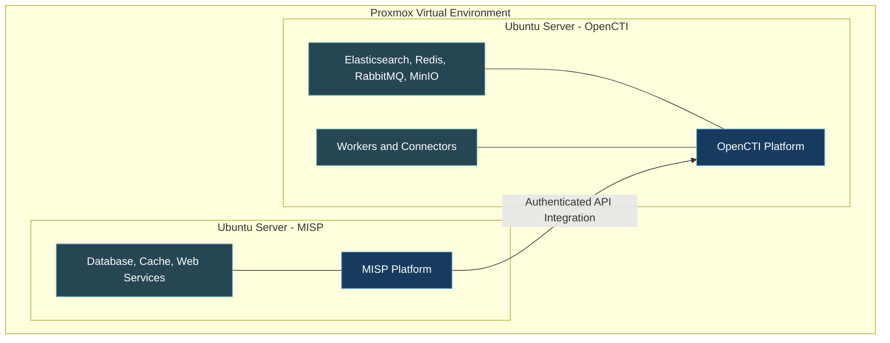
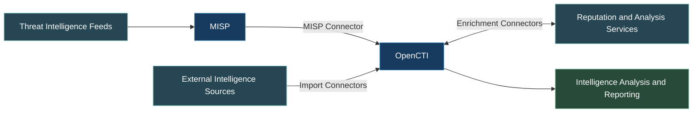

# CTI Lab Architecture

## Overview

This document illustrates the logical architecture of the self-hosted Cyber Threat Intelligence (CTI) laboratory.

The environment uses Proxmox Virtual Environment to host independent MISP and OpenCTI workloads. Docker Compose manages the application services, supporting infrastructure, and threat intelligence connectors.

The diagrams intentionally exclude operational IP addresses, internal hostnames, credentials, and detailed network boundaries.

## Infrastructure Architecture

The MISP and OpenCTI platforms run within separate Ubuntu Server virtual machines. Each application uses Docker-managed services.

## Intelligence Collection and Enrichment

External intelligence sources contribute information through collection and enrichment workflows.

MISP provides event and indicator management, while OpenCTI centralizes intelligence objects, relationships, enrichment results, and analyst reporting.

## Architecture Components

| Component | Primary Responsibility |
|---|---|
| Proxmox VE | Virtualization and workload management |
| Ubuntu Server | Operating system for application workloads |
| Docker Compose | Application and connector orchestration |
| MISP | Intelligence collection and event management |
| OpenCTI | Intelligence correlation, enrichment, and analysis |
| Elasticsearch | Intelligence indexing and search |
| RabbitMQ | Asynchronous message processing |
| Redis | Supporting application services |
| MinIO | Object storage |
| OpenCTI Workers | Background processing |
| Intelligence Connectors | External collection and enrichment |

## Security Design

The architecture incorporates restricted administrative access, authenticated API communication, and separation between application workloads.

OpenCTI management access is performed through an SSH-forwarded connection instead of directly exposing its application interface.

MISP uses HTTPS and controlled access from authorized systems.

The laboratory currently includes a documented certificate trust exception for the MISP connector. Establishing trusted TLS validation remains a future security improvement.

Operational access rules and network identifiers are excluded from the published architecture.

For additional details, see [Network Security and Access Controls](../docs/04-network-security.md).

## Design Considerations

**Modularity:** MISP and OpenCTI are deployed independently so their configurations and services can be maintained separately.

**Scalability:** Docker Compose allows additional connectors and supporting services to be introduced as requirements evolve.

**Resource efficiency:** Application memory and optional services are configured according to available virtual machine resources.

**Security:** Restricted management access, authentication, and configuration isolation reduce unnecessary exposure.

**Analytical flexibility:** The combination of intelligence collection and enrichment services supports multiple investigation workflows.

## Supporting Documentation

- [Infrastructure Deployment](../docs/01-infrastructure-deployment.md)
- [MISP Deployment](../docs/02-misp-deployment.md)
- [OpenCTI Deployment](../docs/03-opencti-deployment.md)
- [Connector Integration](../docs/05-intelligence-connectors.md)
- [Validation and Results](../docs/07-validation-results.md)
