# CTI Lab — Technical Evidence Gallery

This directory contains sanitized screenshots documenting the deployment, integration, operation, and validation of a self-hosted Cyber Threat Intelligence (CTI) laboratory built with **Proxmox VE, MISP, OpenCTI, Ubuntu Server, and Docker**.

The evidence demonstrates an end-to-end intelligence workflow: provisioning the infrastructure, collecting phishing indicators, importing intelligence into OpenCTI, enriching observables, developing a structured intelligence assessment, and modeling relationships between intelligence objects.

Additional evidence documents the operational health of the containerized platform and the ingestion of MITRE ATT&CK intelligence.

Each screenshot is accompanied by an explanation of its technical significance, the capabilities demonstrated, and any relevant validation limitations.

---

## Evidence Index

| # | Screenshot | Evidence |
|---|---|---|
| 01 | [Proxmox Infrastructure](#01-proxmox-infrastructure) | Virtualization and infrastructure resource monitoring |
| 02 | [MISP Dashboard](#02-misp-threat-intelligence-dashboard) | Operational threat intelligence platform |
| 03 | [OpenPhish Feed](#03-misp-openphish-feed-ingestion) | External phishing intelligence collection |
| 04 | [OpenCTI Integrations](#04-opencti-intelligence-integrations) | External import and enrichment connectors |
| 05 | [MISP-to-OpenCTI Ingestion](#05-misp-to-opencti-intelligence-ingestion) | Intelligence transfer between platforms |
| 06 | [Phishing Infrastructure Assessment](#06-opencti-phishing-infrastructure-assessment) | Structured intelligence analysis and reporting |
| 07a–07b | [VirusTotal Enrichment](#07-virustotal-observable-enrichment) | URL enrichment and vendor detection results |
| 08a–08b | [Container Monitoring](#08-opencti-container-monitoring) | Docker resource utilization and health checks |
| 09 | [Intelligence Relationships](#09-opencti-intelligence-relationships) | Indicator relationships and DNS resolution |
| 10a–10b | [MITRE ATT&CK Intelligence](#10-mitre-attck-intelligence-ingestion) | Imported intrusion set intelligence and relationships |

---

## 01. Proxmox Infrastructure


**Figure 1 — Proxmox Virtual Environment**

The Proxmox management interface demonstrates the operational status of the virtualization infrastructure supporting the CTI laboratory.

The environment uses dedicated Ubuntu Server virtual machines for the MISP and OpenCTI platforms. Each application operates in its own Docker Compose environment, providing workload separation and independent service management.

The screenshot documents the virtualization environment and supports verification of infrastructure resource monitoring.

**Technical significance:** The laboratory demonstrates the ability to provision and maintain the infrastructure required to host multiple interconnected threat intelligence platforms.

---

## 02. MISP Threat Intelligence Dashboard


**Figure 2 — Operational MISP Platform**

The MISP dashboard demonstrates successful deployment and access to the Malware Information Sharing Platform.

MISP serves as the laboratory's primary intelligence collection and management platform, providing capabilities for organizing intelligence into events, managing observable attributes, and sharing collected information with downstream systems.

The operational dashboard establishes that the MISP application was accessible and available for intelligence collection.

**Technical significance:** MISP provides the upstream collection component of the laboratory's intelligence pipeline.

---

## 03. MISP OpenPhish Feed Ingestion

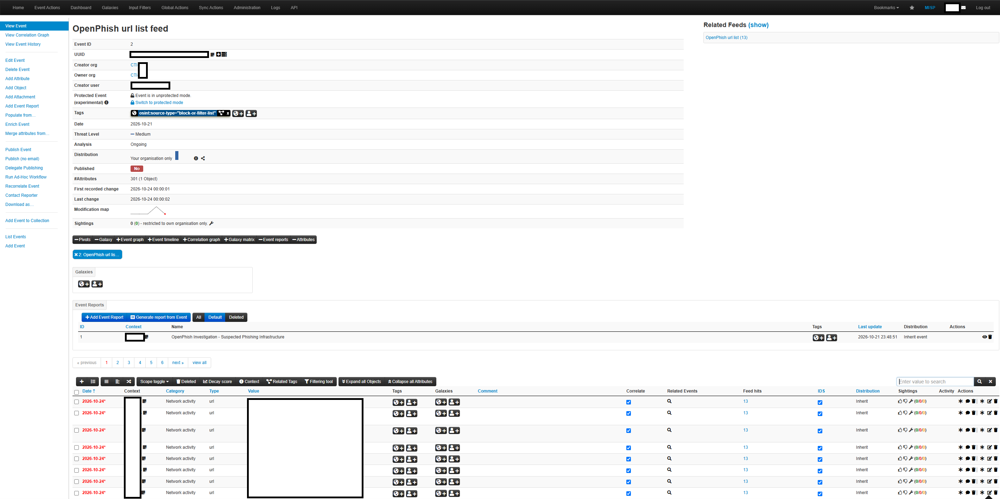

**Figure 3 — OpenPhish Threat Intelligence Feed Import**

This screenshot demonstrates the collection of URL-based phishing intelligence through the OpenPhish feed.

The imported intelligence was organized within a MISP event containing URL attributes, allowing collected observables to be managed, reviewed, and shared.

The screenshot supports verification of:

- External intelligence feed ingestion.
- Event and attribute creation in MISP.
- Organization of suspicious URL observables.
- Availability of the event for downstream OpenCTI ingestion.

Sensitive administrative information, internal identifiers, and source event details were sanitized before publication.

**Technical significance:** The OpenPhish integration provides a practical example of automated intelligence collection rather than relying exclusively on manually entered indicators.

---

## 04. OpenCTI Intelligence Integrations

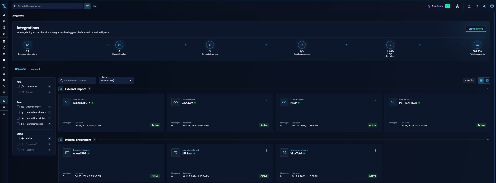

**Figure 4 — OpenCTI External Import and Enrichment Connectors**

The OpenCTI integrations interface demonstrates the deployment and registration of multiple intelligence connectors.

### External intelligence sources

| Integration | Function |
|---|---|
| MISP | Import structured threat intelligence and observables |
| MITRE ATT&CK | Import adversary behavior and intrusion set intelligence |
| AlienVault OTX | Import community-contributed threat intelligence |
| CISA KEV | Import known exploited vulnerability intelligence |

### Enrichment services

| Integration | Function |
|---|---|
| VirusTotal | Enrich observables with security vendor detection and reputation information |
| urlscan.io | Support URL and website investigations |
| AbuseIPDB | Retrieve IP address reputation and abuse reporting context |

The connectors shown in the screenshot were registered as active at the time of capture.

**Validation distinction:** Active connector status verifies registration and communication with OpenCTI. It does not independently establish that every intelligence source has completed all scheduled imports.

**Technical significance:** The integration architecture enables OpenCTI to aggregate intelligence from complementary sources and support enrichment-driven investigations.

---

## 05. MISP-to-OpenCTI Intelligence Ingestion

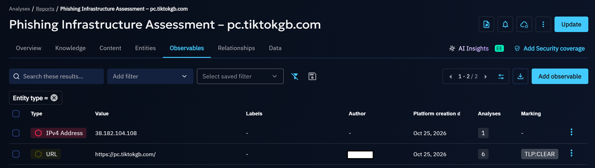

**Figure 5 — MISP Intelligence Accessible Through OpenCTI**

This screenshot demonstrates the availability of OpenPhish intelligence within OpenCTI following ingestion through the configured MISP connector.

The intelligence workflow is:

**OpenPhish → MISP → OpenCTI**

MISP collects and organizes URL-based intelligence, while OpenCTI provides a centralized environment for viewing, investigating, enriching, and correlating the imported information.

The imported OpenPhish report provides evidence that collected intelligence can be transferred into OpenCTI and made available for subsequent analyst workflows.

**Technical significance:** The integration demonstrates communication between two independently deployed threat intelligence platforms and establishes the foundation for centralized analysis.

---

## 06. OpenCTI Phishing Infrastructure Assessment

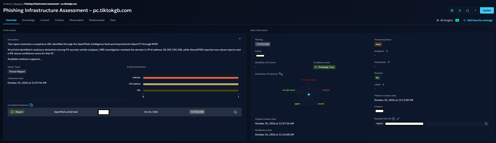

**Figure 6 — Structured Phishing Infrastructure Intelligence Assessment**

This screenshot demonstrates an analyst-created intelligence assessment developed using OpenCTI.

The investigation focused on the suspicious URL:

`https://pc.tiktokgb.com/`

During the investigation, the domain was observed resolving to:

`38.182.104.108`

The assessment incorporated multiple intelligence sources and investigative findings.

| Source | Investigation finding |
|---|---|
| OpenPhish | Identified the suspicious URL through an intelligence feed |
| MISP | Collected and organized the URL intelligence |
| OpenCTI | Supported investigation and structured intelligence reporting |
| VirusTotal | Returned 6 malicious detections among 93 security vendor analyses |
| AbuseIPDB | Returned 0 abuse reports and a 0% abuse confidence score for the IP |
| DNS investigation | Identified the associated IPv4 address during the investigation |

These results reflect observations obtained during the October 25, 2026 investigation and should not be interpreted as continuously current threat intelligence.

The OpenCTI report documents the investigation's findings, related observables, confidence information, and correlation with the original imported intelligence.

**Analytical significance:** The assessment demonstrates the transition from collecting indicators to evaluating multiple sources, documenting uncertainty, and producing an intelligence report.

A limited number of reputation detections or an absence of abuse reports does not independently establish whether infrastructure is malicious or benign.

---

## 07. VirusTotal Observable Enrichment

### 07a. Observable Overview and Integration History

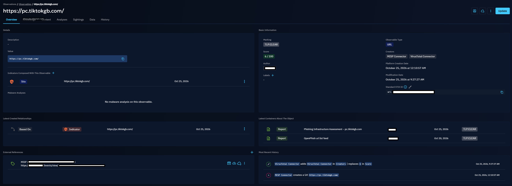

**Figure 7a — URL Observable Enriched Through VirusTotal**

The OpenCTI observable interface demonstrates the URL record originally created through the MISP connector and subsequently enriched through the VirusTotal connector.

The screenshot displays the investigated URL, associated indicator, related intelligence reports, observable scoring, and an activity history recording the VirusTotal enrichment update.

The observable's creator information identifies both the MISP and VirusTotal connectors, supporting traceability between original intelligence collection and subsequent enrichment.

Private MISP management information, internal references, and laboratory identifiers were redacted before publication.

### 07b. VirusTotal Enrichment Results

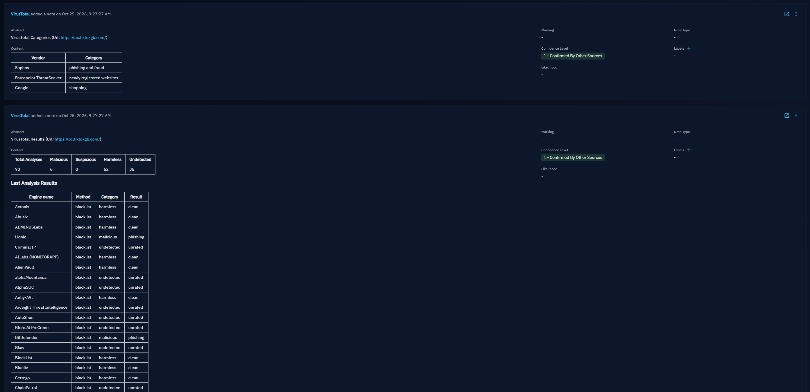

**Figure 7b — VirusTotal Enrichment Notes and Vendor Classifications**

The enrichment connector generated notes containing the VirusTotal detection summary and individual security vendor classifications.

The investigation returned the following results:

| Classification | Count |
|---|---:|
| Total analyses | 93 |
| Malicious | 6 |
| Suspicious | 0 |
| Harmless | 52 |
| Undetected | 35 |

The visible vendor classifications included a phishing/fraud categorization from Sophos, alongside differing classifications from other security vendors.

These findings illustrate how enrichment data can supplement an investigation without eliminating uncertainty.

**Technical significance:** The screenshots validate that the VirusTotal integration can retrieve intelligence about an observable and record the resulting context in OpenCTI.

**Analytical significance:** Security vendor disagreement reinforces the need to assess reputation results alongside other evidence rather than interpreting a single score as a definitive conclusion.

---

## 08. OpenCTI Container Monitoring

### 08a. Docker Resource Utilization

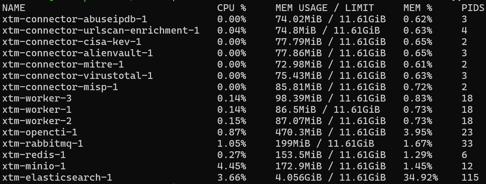

**Figure 8a — Docker Container CPU and Memory Utilization**

Docker resource monitoring was performed on the Ubuntu Server virtual machine hosting OpenCTI.

The command used to collect the evidence was:

```bash
sudo docker stats --no-stream --format "table {{.Name}}\t{{.CPUPerc}}\t{{.MemUsage}}\t{{.MemPerc}}\t{{.PIDs}}"
```

The output provides a point-in-time view of CPU consumption, memory usage, memory limits, and process counts across the deployed services.

At the time of capture, notable observations included:

| Component | Approximate memory usage |
|---|---:|
| Elasticsearch | 4.06 GiB |
| OpenCTI platform | 470 MiB |
| RabbitMQ | 199 MiB |
| Redis | 154 MiB |
| MinIO | 173 MiB |
| OpenCTI workers | Approximately 272 MiB combined |
| Intelligence connectors | Approximately 539 MiB combined |

Elasticsearch represented the largest memory consumer, consistent with its role as the platform's search and data indexing backend.

The remaining application services, workers, and intelligence connectors showed relatively low resource utilization at the time of monitoring.

**Validation distinction:** A single resource snapshot demonstrates current consumption, not long-term performance, capacity under heavy ingestion, or historical availability.

### 08b. Docker Container Health

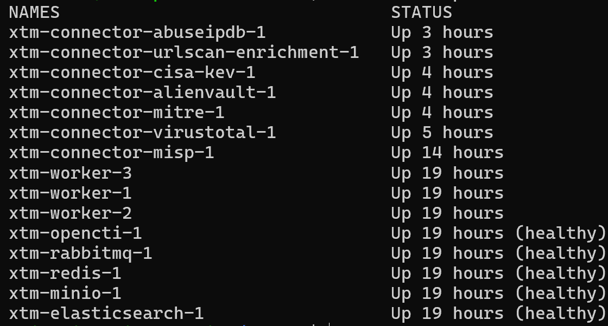

**Figure 8b — Container Availability and Docker Health Checks**

The following command was used to inspect running containers and their status:

```bash
sudo docker ps --format "table {{.Names}}\t{{.Status}}"
```

The screenshot confirms that the OpenCTI platform, supporting infrastructure services, workers, and intelligence connectors were running when captured.

The primary services reporting passing Docker health checks included:

- OpenCTI platform.
- Elasticsearch.
- RabbitMQ.
- Redis.
- MinIO.

The workers and intelligence connectors were also running, although their displayed `Up` status does not independently confirm successful processing or comprehensive health-check coverage.

Differences in container uptime reflect ongoing deployment and configuration activities.

**Technical significance:** These screenshots demonstrate operational administration, resource monitoring, and service validation of the underlying OpenCTI platform.

---

## 09. OpenCTI Intelligence Relationships

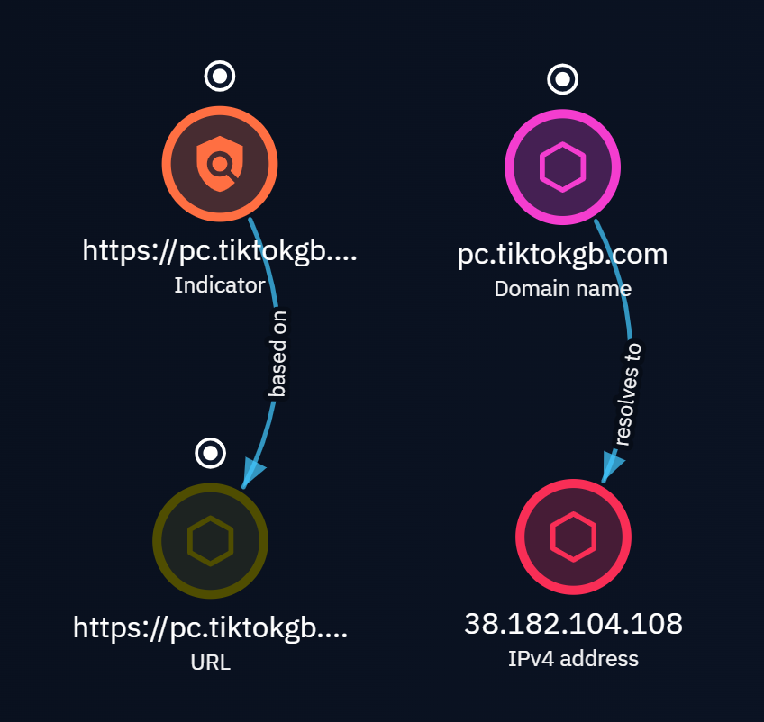

**Figure 9 — Intelligence Relationship Modeling in OpenCTI**

This screenshot demonstrates the use of OpenCTI's Knowledge Graph to represent relationships between intelligence objects identified during the phishing infrastructure investigation.

The graph contains two documented relationships.

### Indicator-to-observable relationship

**Indicator → Based On → URL Observable**

This relationship associates the suspicious URL indicator with the underlying observable from which it was derived.

### Domain-to-IP relationship

**Domain Name → Resolves To → IPv4 Address**

- Domain: `pc.tiktokgb.com`
- IPv4 address: `38.182.104.108`
- Observation date: October 25, 2026

The DNS relationship represents resolution observed during the investigation and should not be interpreted as a permanent mapping or evidence that the resolved IP address is inherently malicious.

The domain and IPv4 observables were associated using OpenCTI's nested observable reference capabilities, and the relevant relationship was also made visible in the report's Knowledge Graph.

**Technical significance:** The graph demonstrates how OpenCTI can model structured connections between indicators, observables, and infrastructure.

**Analytical significance:** Explicit relationships help analysts distinguish observed technical associations from assumptions, allowing intelligence to be interpreted with greater context.

---

## 10. MITRE ATT&CK Intelligence Ingestion

### 10a. APT5 Intrusion Set Overview

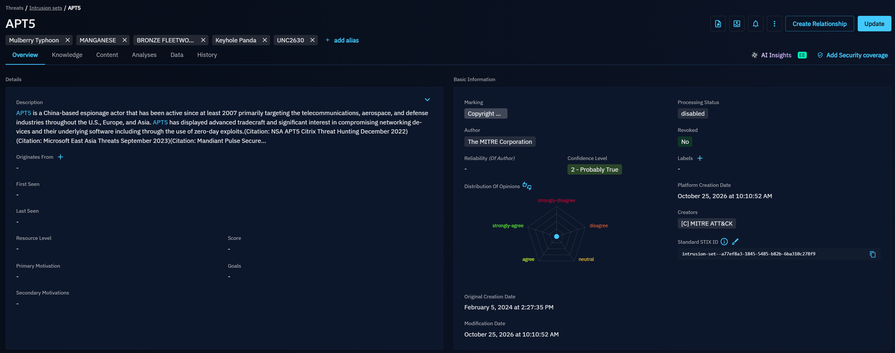

**Figure 10a — MITRE ATT&CK Intrusion Set Imported into OpenCTI**

The OpenCTI APT5 intrusion set page demonstrates the ingestion of structured intelligence through the MITRE ATT&CK connector.

The imported record includes:

- Intrusion set name and description.
- Known aliases.
- MITRE Corporation attribution as the intelligence author.
- Confidence metadata.
- STIX identification information.
- Supporting intelligence references.

Aliases displayed in the record include MANGANESE, BRONZE FLEETWOOD, and UNC2630, among others.

The record illustrates how OpenCTI organizes externally sourced adversary intelligence into a consistent data model.

### 10b. APT5 Relationships and Supporting References

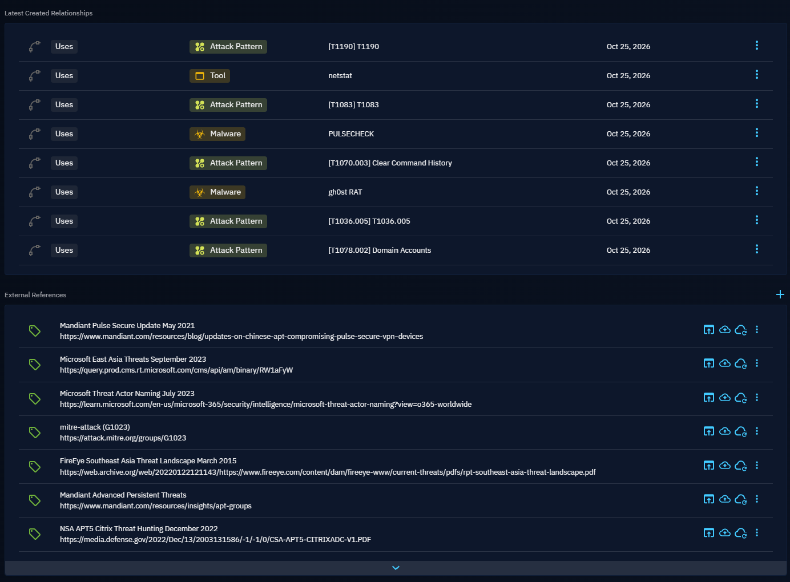

**Figure 10b — Imported Adversary Relationships and External References**

The APT5 record includes relationships with attack patterns, tools, and malware represented in the MITRE ATT&CK dataset.

Examples visible in the screenshot include:

| Intelligence type | Imported example |
|---|---|
| Attack Pattern | T1190 |
| Attack Pattern | T1083 |
| Attack Pattern | T1070.003 — Clear Command History |
| Attack Pattern | T1036.005 |
| Attack Pattern | T1078.002 — Domain Accounts |
| Tool | netstat |
| Malware | PULSECHECK |
| Malware | gh0st RAT |

The record also includes public supporting references from MITRE ATT&CK, Mandiant, Microsoft, and other threat intelligence publications.

These records provide evidence that the MITRE ATT&CK connector ingested structured intelligence relationships rather than only threat actor names.

**Technical significance:** The imported dataset supports adversary-centric analysis, technique investigation, and correlation across structured threat intelligence objects.

**Validation distinction:** Imported ATT&CK relationships represent source-provided intelligence. Their presence does not establish that the APT5 intrusion set is associated with the separately investigated phishing URL.

---

## End-to-End Intelligence Workflow

The evidence gallery documents an implemented intelligence workflow spanning collection, ingestion, enrichment, investigation, and reporting.

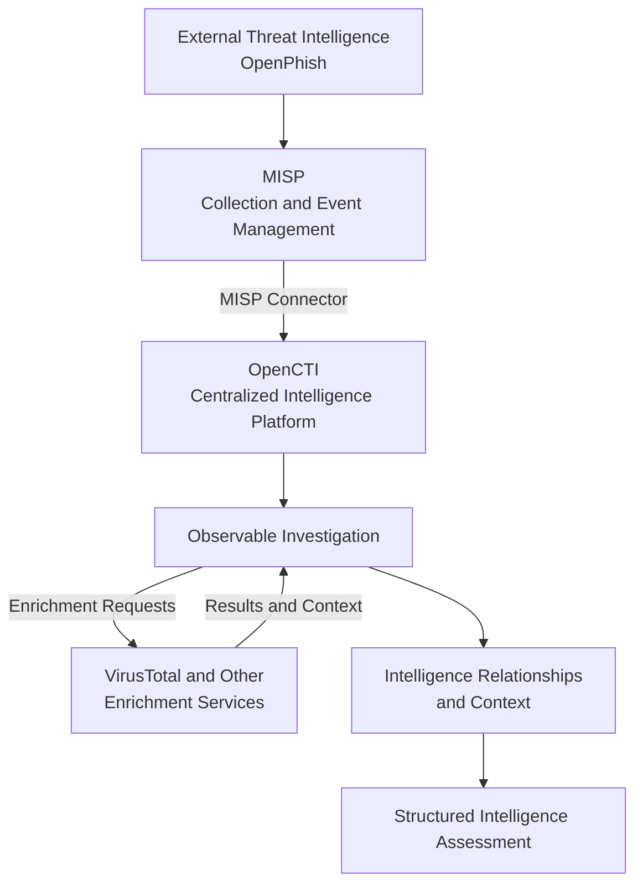

The laboratory also incorporates external intelligence datasets, including MITRE ATT&CK, AlienVault OTX, and CISA KEV, that provide additional analytical context and independent intelligence collection capabilities.

The workflow separates the collection of potentially relevant information from the assessment of that information. Imported data, enrichment findings, and analyst judgments are documented as distinct components.

---

## Evidence Collection Methodology

Screenshots are collected to validate technical capabilities and support the accompanying deployment documentation.

Evidence is reviewed according to the following principles:

1. **Authenticity:** Images originate from the deployed laboratory environment.
2. **Technical relevance:** Each screenshot demonstrates a specific configuration, system capability, or investigation result.
3. **Traceability:** Supporting evidence is associated with its relevant technical documentation.
4. **Accuracy:** Captions distinguish between observed results, platform status, and analytical conclusions.
5. **Security:** Confidential operational information is removed before publication.
6. **Clarity:** Evidence is organized and cropped to maintain readability.
7. **Reproducibility:** Where appropriate, the commands and workflows used for validation are documented.

Screenshots demonstrate the state of the environment at the time of capture and should not be interpreted as continuous monitoring or proof of long-term platform reliability.

---

## Security and Privacy

All screenshots are reviewed and sanitized before being committed to the repository.

Information excluded from public evidence includes:

- Private IP addresses and internal network ranges.
- Internal DNS names and management endpoints.
- Administrative account identifiers where unnecessary.
- Passwords, API keys, authentication tokens, and session information.
- Sensitive application configuration values.
- Internal MISP management URLs and event identifiers.
- Other infrastructure details that do not contribute to the technical explanation.

Public threat intelligence indicators, including suspicious domains and IP addresses, may remain visible when directly relevant to an investigation.

Sensitive values are permanently obscured in exported screenshots rather than concealed using reversible overlays or visual blur effects.

Original images containing confidential operational information are not included in the public evidence gallery.

---

## Supporting Documentation

For additional information about the laboratory's infrastructure, architecture, integrations, and operational validation, see the technical documentation.

| Document | Description |
|---|---|
| [Infrastructure Deployment](../docs/01-infrastructure-deployment.md) | Virtualization, Ubuntu Server provisioning, and deployment preparation |
| [MISP Deployment](../docs/02-misp-deployment.md) | MISP configuration, intelligence collection, and API integration |
| [OpenCTI Deployment](../docs/03-opencti-deployment.md) | OpenCTI services, orchestration, and deployment configuration |
| [Network Security](../docs/04-network-security.md) | Access restrictions, TLS, authentication, and network controls |
| [Intelligence Connectors](../docs/05-intelligence-connectors.md) | External collection and enrichment integrations |
| [Troubleshooting](../docs/06-troubleshooting.md) | Root-cause analysis, corrective actions, and lessons learned |
| [Validation Results](../docs/07-validation-results.md) | Operational and intelligence workflow validation |
| [Technical Architecture](../architecture/README.md) | System architecture and intelligence data flows |
| [Main Project README](../README.md) | Project overview, objectives, and documentation navigation |

---

## Continued Development

This evidence collection represents the initial operational validation of the CTI laboratory.

Future development may include additional intelligence integrations, infrastructure hardening, automated collection workflows, expanded observable relationships, and dedicated intelligence case studies.

The laboratory is maintained as an evolving environment for practicing threat intelligence operations, investigation methodology, and infrastructure administration.
