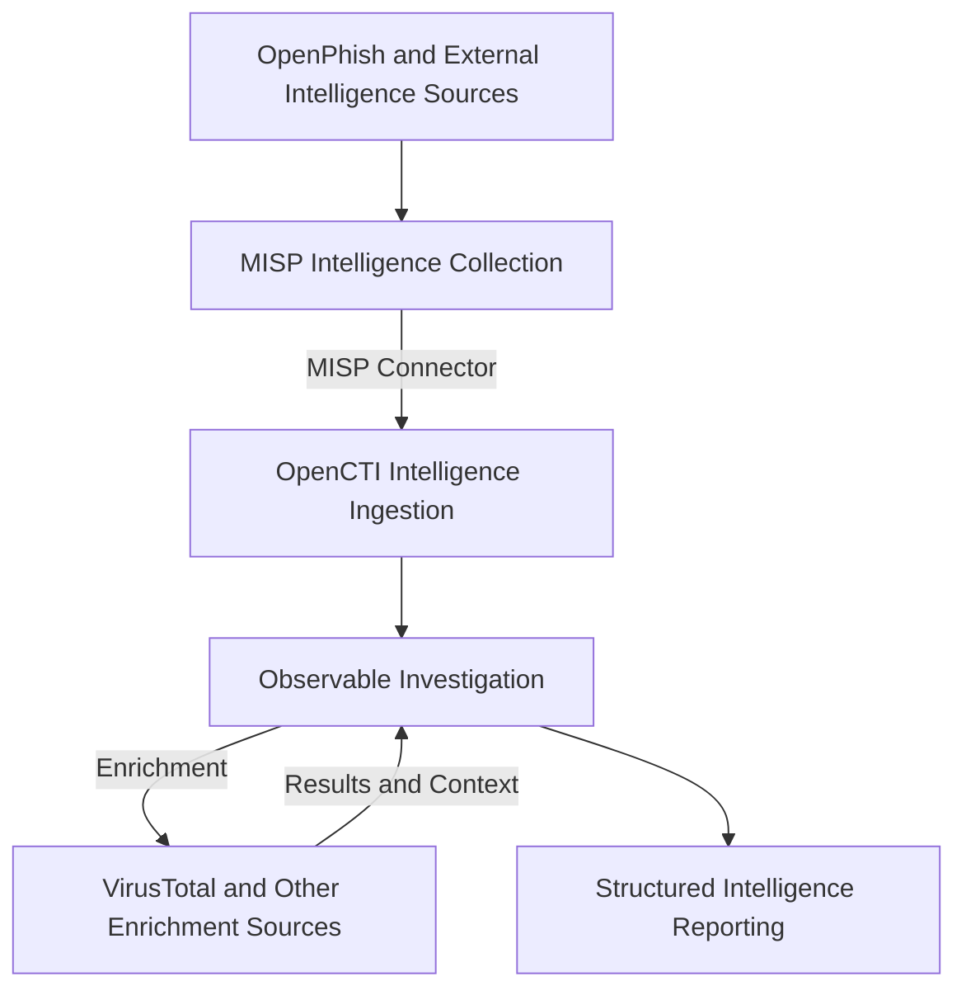

# CTI Lab Evidence

This directory contains sanitized screenshots documenting the deployment, configuration, integration, and validation of a self-hosted Cyber Threat Intelligence (CTI) laboratory built with Proxmox, MISP, and OpenCTI.

The evidence demonstrates operational infrastructure, threat intelligence collection, ingestion, enrichment, and structured intelligence reporting.

---

## Evidence Index

| Screenshot | Evidence | Description |
|---|---|---|
| 01 | [Proxmox Infrastructure](#01-proxmox-infrastructure) | Virtualization and infrastructure monitoring |
| 02 | [MISP Dashboard](#02-misp-threat-intelligence-dashboard) | Operational MISP platform |
| 03 | [MISP OpenPhish Feed](#03-misp-openphish-feed-ingestion) | External phishing intelligence collection |
| 04 | [OpenCTI Integrations](#04-opencti-intelligence-integrations) | Intelligence import and enrichment connectors |
| 05 | [MISP-to-OpenCTI Ingestion](#05-misp-to-opencti-intelligence-ingestion) | Imported intelligence accessible in OpenCTI |
| 06 | [Intelligence Assessment](#06-opencti-phishing-infrastructure-assessment) | Structured phishing infrastructure analysis |
| 07a–07b | [VirusTotal Enrichment](#07-virustotal-enrichment) | Observable enrichment and detection results |

---

## 01. Proxmox Infrastructure

**Figure 1 — Proxmox Virtual Environment**

The Proxmox management dashboard demonstrates the operational status of the virtualized infrastructure supporting the laboratory.

Dedicated Ubuntu Server virtual machines host MISP and OpenCTI as independent containerized deployments, providing workload separation and independent resource management.

The screenshot documents virtualization availability, active workloads, and infrastructure resource monitoring.

---

## 02. MISP Threat Intelligence Dashboard

**Figure 2 — Operational MISP Platform**

The MISP dashboard demonstrates the deployment and availability of the intelligence collection platform.

MISP supports the ingestion, organization, management, and sharing of threat intelligence events and attributes.

The platform serves as an upstream intelligence source for OpenCTI.

---

## 03. MISP OpenPhish Feed Ingestion

**Figure 3 — OpenPhish Threat Intelligence Collection**

The screenshot demonstrates the ingestion of URL-based phishing intelligence through the OpenPhish feed.

Imported URL attributes are organized into MISP events, supporting investigation and downstream sharing with OpenCTI.

Sensitive administrative information and internal identifiers have been redacted.

---

## 04. OpenCTI Intelligence Integrations

**Figure 4 — OpenCTI Intelligence Connectors**

The OpenCTI integrations interface demonstrates configured connectors supporting intelligence collection and observable enrichment.

External intelligence collection includes MISP, MITRE ATT&CK, AlienVault OTX, and CISA KEV.

Enrichment services include VirusTotal, urlscan.io, and AbuseIPDB.

Active connector status confirms registration and connectivity at the time of capture. Intelligence ingestion and enrichment are validated separately.

---

## 05. MISP-to-OpenCTI Intelligence Ingestion

**Figure 5 — Imported MISP Intelligence Available in OpenCTI**

This screenshot documents intelligence collected through MISP and subsequently made available within OpenCTI through the MISP connector.

The workflow follows:

**OpenPhish → MISP → OpenCTI**

The imported intelligence can be accessed for investigation, correlation, observable enrichment, and structured reporting.

This demonstrates integration between the collection and analysis platforms.

---

## 06. OpenCTI Phishing Infrastructure Assessment

**Figure 6 — Phishing Infrastructure Intelligence Assessment**

This screenshot demonstrates the creation of a structured intelligence assessment using OpenCTI.

The investigation examined the suspicious URL `https://pc.tiktokgb.com/` and associated IPv4 address `38.182.104.108`.

The assessment incorporates intelligence originating from OpenPhish and MISP, together with enrichment findings from VirusTotal and AbuseIPDB.

VirusTotal identified six malicious detections among 93 security vendor analyses at the time of investigation.

AbuseIPDB returned zero abuse reports and a 0% abuse confidence score for the investigated IP address.

The report demonstrates how collected intelligence can be enriched, evaluated, and organized into an analyst-produced intelligence assessment.

The findings are interpreted as supporting evidence rather than definitive attribution or proof of malicious activity.

---

## 07. VirusTotal Enrichment

### 07a. OpenCTI Observable Overview

**Figure 7a — URL Observable and VirusTotal Integration**

The OpenCTI observable interface demonstrates the enrichment of a URL originally imported through the MISP connector.

The observable retains its relationship with the imported OpenPhish intelligence report and the subsequent phishing infrastructure assessment.

The interface also displays the MISP and VirusTotal connectors as creators of the observable record, providing evidence that intelligence from multiple sources was incorporated into the platform.

The activity history documents a VirusTotal enrichment update to the observable's score.

Sensitive MISP management details and laboratory identifiers have been redacted, while public investigation indicators remain visible.

### 07b. VirusTotal Detection Results

**Figure 7b — VirusTotal Enrichment Notes and Security Vendor Classifications**

This screenshot demonstrates the intelligence returned by VirusTotal and recorded within OpenCTI as enrichment notes.

At the time of investigation, the enrichment results included:

| Classification | Results |
|---|---:|
| Total security vendor analyses | 93 |
| Malicious | 6 |
| Suspicious | 0 |
| Harmless | 52 |
| Undetected | 35 |

The enrichment notes also contain individual vendor classifications.

For example, Sophos categorized the URL as phishing and fraud, while other vendors returned different classifications.

These discrepancies illustrate the importance of evaluating threat intelligence across multiple sources rather than relying exclusively on a single reputation score.

The results provide additional context for the structured phishing infrastructure assessment documented in Screenshot 06.

---

## Intelligence Workflow Summary

The laboratory implements a threat intelligence workflow spanning collection, ingestion, enrichment, and analysis.

The workflow demonstrates how collected intelligence becomes available for investigation and can be supplemented by additional intelligence sources before being incorporated into an analytical report.

---

## Evidence Collection and Validation

Screenshots are collected to document operational capabilities and meaningful implementation results.

The evidence follows these principles:

1. **Authenticity:** Screenshots originate from the deployed laboratory.
2. **Relevance:** Each screenshot demonstrates an implementation step or technical capability.
3. **Accuracy:** Captions distinguish observed results from assumptions.
4. **Traceability:** Evidence aligns with the project's technical documentation.
5. **Security:** Confidential operational information is excluded before publication.
6. **Clarity:** Screenshots are cropped to emphasize relevant details.

---

## Security and Privacy

All screenshots undergo a review for sensitive information before being committed to the repository.

The following information is excluded or sanitized:

- Internal IP addresses and network ranges.
- Private DNS names and management endpoints.
- API keys, passwords, authentication tokens, and session data.
- Personal and administrative account identifiers.
- Sensitive platform configuration details.
- Internal event identifiers and management URLs.

Public threat intelligence observables may remain visible where they are directly relevant to the investigation.

Redactions are permanently applied to the exported images.

---

## Supporting Documentation

| Documentation | Description |
|---|---|
| [Infrastructure Deployment](../docs/01-infrastructure-deployment.md) | Infrastructure provisioning and container preparation |
| [MISP Deployment](../docs/02-misp-deployment.md) | Threat intelligence collection and MISP configuration |
| [OpenCTI Deployment](../docs/03-opencti-deployment.md) | OpenCTI platform and supporting services |
| [Network Security](../docs/04-network-security.md) | Network restrictions, TLS, and access controls |
| [Intelligence Connectors](../docs/05-intelligence-connectors.md) | Intelligence collection and enrichment integrations |
| [Troubleshooting](../docs/06-troubleshooting.md) | Root-cause investigations and corrective actions |
| [Validation Results](../docs/07-validation-results.md) | Operational validation and intelligence workflows |
| [Architecture](../architecture/README.md) | Platform architecture and intelligence data flows |

---

## Future Evidence

Additional screenshots may document infrastructure resource utilization, observable relationships, advanced enrichment, new intelligence feeds, and further analytical investigations.

The evidence gallery will continue to expand as new laboratory capabilities are implemented and validated.
