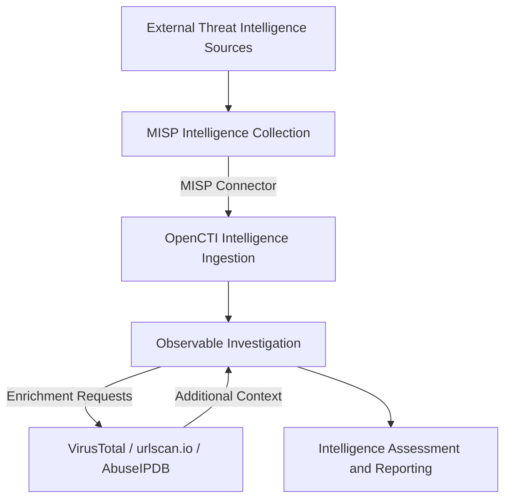

# CTI Lab Evidence

This directory contains sanitized screenshots documenting the deployment, configuration, integration, and validation of a self-hosted Cyber Threat Intelligence (CTI) laboratory built with Proxmox, MISP, and OpenCTI.

The screenshots provide supporting evidence of operational infrastructure, intelligence collection, platform integration, intelligence ingestion, and analytical reporting.

Each image is accompanied by an explanation of the technical capability demonstrated and its relevance to the overall threat intelligence workflow.

---

## Evidence Index

| Screenshot | Evidence | Description |
|---|---|---|
| 01 | [Proxmox Infrastructure](#01-proxmox-infrastructure) | Virtualization and infrastructure resource monitoring |
| 02 | [MISP Dashboard](#02-misp-threat-intelligence-dashboard) | Operational threat intelligence collection platform |
| 03 | [MISP OpenPhish Feed](#03-misp-openphish-feed-ingestion) | Collection of URL-based phishing intelligence |
| 04 | [OpenCTI Integrations](#04-opencti-intelligence-integrations) | External intelligence collection and enrichment connectors |
| 05 | [MISP-to-OpenCTI Ingestion](#05-misp-to-opencti-intelligence-ingestion) | Transferred intelligence accessible in OpenCTI |
| 06 | [OpenCTI Intelligence Assessment](#06-opencti-phishing-infrastructure-assessment) | Structured analysis of suspicious phishing infrastructure |

---

## 01. Proxmox Infrastructure

**Figure 1 — Proxmox Virtual Environment**

The Proxmox management interface demonstrates the operational status of the virtualized infrastructure supporting the CTI laboratory.

The environment uses dedicated Ubuntu Server virtual machines for MISP and OpenCTI, providing separation between the intelligence collection and analysis platforms.

The screenshot provides evidence of:

- Operational virtualization infrastructure.
- Resource availability and utilization monitoring.
- Dedicated virtual machine workloads.
- Centralized infrastructure administration.

Proxmox provides the underlying compute and virtualization capabilities required to operate the containerized threat intelligence platforms.

---

## 02. MISP Threat Intelligence Dashboard

**Figure 2 — Operational MISP Platform**

The MISP dashboard demonstrates the deployment and availability of the Malware Information Sharing Platform.

MISP serves as an intelligence collection and management platform, supporting the ingestion, organization, and sharing of structured threat intelligence.

The screenshot provides evidence of:

- Successful deployment of the MISP application.
- Access to the intelligence management interface.
- Event and attribute management capabilities.
- Intelligence collection and reporting functionality.

MISP provides an upstream intelligence source for the OpenCTI environment.

---

## 03. MISP OpenPhish Feed Ingestion

**Figure 3 — OpenPhish Threat Intelligence Collection**

This screenshot demonstrates the ingestion of URL-based phishing intelligence into MISP through the OpenPhish threat intelligence feed.

The collected intelligence is organized into an event containing URL attributes, making it accessible for investigation, management, and sharing with other intelligence platforms.

The screenshot provides evidence of:

- External threat intelligence feed ingestion.
- Creation and population of a MISP intelligence event.
- Organization of phishing-related URL attributes.
- Availability of imported intelligence for downstream integration.

Sensitive MISP administrative information and identifiers have been redacted.

This collection workflow establishes MISP as a source of intelligence for OpenCTI.

---

## 04. OpenCTI Intelligence Integrations

**Figure 4 — OpenCTI External Import and Enrichment Connectors**

The OpenCTI integrations interface demonstrates the deployment and registration of connectors supporting external intelligence collection and observable enrichment.

The laboratory incorporates the following intelligence sources and services.

**External intelligence collection:**

- MISP — Imported intelligence events, reports, and observables.
- MITRE ATT&CK — Structured adversary behavior intelligence.
- AlienVault OTX — Community-driven threat intelligence.
- CISA KEV — Information about known exploited vulnerabilities.

**Internal intelligence enrichment:**

- VirusTotal — URL, domain, IP address, and file reputation context.
- urlscan.io — Website and URL investigation.
- AbuseIPDB — IP address reputation and abuse reporting.

The screenshot provides evidence of connector registration, active status, and integration monitoring.

Connector availability is distinguished from successful data processing; intelligence ingestion and enrichment are validated separately through platform records and investigation results.

---

## 05. MISP-to-OpenCTI Intelligence Ingestion

**Figure 5 — Imported MISP Intelligence Available in OpenCTI**

This screenshot demonstrates intelligence collected through MISP being made available within OpenCTI through the configured MISP connector.

The OpenPhish intelligence report provides a practical example of transferring intelligence from an upstream collection platform into a centralized intelligence analysis environment.

The workflow follows this path:

**OpenPhish → MISP → OpenCTI**

The screenshot provides evidence of:

- Availability of the imported OpenPhish report within OpenCTI.
- Integration between MISP and OpenCTI.
- Representation of imported intelligence within the analysis platform.
- Access to collected intelligence for subsequent investigation and enrichment.

This workflow demonstrates how external threat intelligence can move between platforms without requiring the analyst to manually recreate the original intelligence records.

It also provides the foundation for follow-on analysis of suspicious URLs, associated IP addresses, and related observables.

---

## 06. OpenCTI Phishing Infrastructure Assessment

**Figure 6 — Structured Phishing Infrastructure Intelligence Assessment**

This screenshot demonstrates the creation of a structured intelligence report within OpenCTI using intelligence initially identified through the OpenPhish feed and imported via MISP.

The investigation examined the suspicious URL `https://pc.tiktokgb.com/` and its associated IPv4 address, `38.182.104.108`.

The analysis incorporated several sources of intelligence and enrichment data:

- **OpenPhish:** Initial identification of the suspicious URL.
- **MISP:** Collection and organization of the URL-based intelligence.
- **OpenCTI:** Centralized investigation and intelligence reporting.
- **VirusTotal:** Six malicious detections among 93 security vendor analyses at the time of investigation.
- **AbuseIPDB:** No abuse reports and a 0% abuse confidence score for the investigated IP address at the time of enrichment.
- **DNS investigation:** Resolution of the suspicious domain to the associated IPv4 address.

The intelligence assessment documents the relationship between the investigated URL, the associated IPv4 observable, and the indicators used during analysis.

The report also demonstrates the use of structured intelligence reporting features, including entity distribution, confidence assessment, TLP classification, and correlation with imported intelligence.

The findings illustrate how multiple intelligence sources can be combined to develop a more complete understanding of suspicious infrastructure.

Importantly, differences between reputation services are evaluated as separate evidence rather than treated as definitive proof of malicious or benign activity.

This investigation demonstrates the progression from intelligence collection to enrichment, contextual analysis, and structured reporting.

---

## Intelligence Workflow Summary

The collected screenshots document a practical intelligence lifecycle implemented across the laboratory.

The workflow demonstrates the separation of intelligence collection, centralized management, enrichment, and analytical reporting.

Each stage contributes additional context to support threat intelligence investigations and evidence-based assessments.

---

## Evidence Collection and Validation

Screenshots are selected to document meaningful technical capabilities, system configurations, or operational results.

Evidence is evaluated using the following principles:

1. **Authenticity:** Screenshots originate from the deployed laboratory environment.
2. **Technical relevance:** Each image illustrates a specific implementation or intelligence workflow.
3. **Traceability:** Evidence corresponds to the associated technical documentation.
4. **Validation:** Screenshots support claims about system operation without overstating what the displayed information proves.
5. **Security:** Confidential information is removed before publication.
6. **Clarity:** Images are cropped and organized to focus on the relevant technical details.

Where applicable, screenshots distinguish between successful platform connectivity, successful data ingestion, and completed analyst investigations.

---

## Security and Privacy

All screenshots are reviewed and sanitized before being committed to the repository.

Information excluded from published evidence includes:

- Internal IP addresses and private network ranges.
- Internal DNS names and management hostnames.
- Authentication credentials and API keys.
- Session tokens and authentication headers.
- Personal or administrative account identifiers.
- Sensitive infrastructure configuration details.
- Internal identifiers that are not necessary to demonstrate technical functionality.

Public threat intelligence observables, including suspicious domains and IP addresses examined during the investigation, may remain visible when they are relevant to the documented analysis.

Redactions are permanently applied to exported images. Original screenshots containing confidential information are not included in the repository.

---

## Supporting Documentation

The screenshots complement the technical implementation guides available in the main repository.

| Documentation | Description |
|---|---|
| [Infrastructure Deployment](../docs/01-infrastructure-deployment.md) | Virtual machine provisioning, infrastructure planning, and Docker deployment |
| [MISP Deployment](../docs/02-misp-deployment.md) | Intelligence collection, MISP configuration, and feed integration |
| [OpenCTI Deployment](../docs/03-opencti-deployment.md) | OpenCTI services, container deployment, and application configuration |
| [Network Security](../docs/04-network-security.md) | Management access restrictions, authentication, TLS, and network controls |
| [Intelligence Connectors](../docs/05-intelligence-connectors.md) | External intelligence ingestion and enrichment integrations |
| [Troubleshooting](../docs/06-troubleshooting.md) | Technical issues, root-cause analysis, and corrective actions |
| [Validation Results](../docs/07-validation-results.md) | Operational verification and intelligence workflow results |
| [Architecture](../architecture/README.md) | System components, architecture diagrams, and intelligence data flows |

---

## Future Evidence

As the laboratory develops, additional evidence may document:

- Detailed indicator enrichment results.
- Observable relationships and intelligence graphs.
- Threat actor and MITRE ATT&CK technique correlation.
- Infrastructure performance and container resource monitoring.
- Expanded threat intelligence collection workflows.
- Additional intelligence assessments and investigation case studies.

The evidence gallery will continue to evolve as new capabilities are deployed, tested, and documented.
